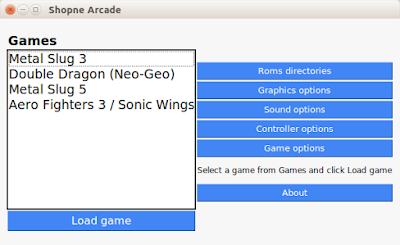
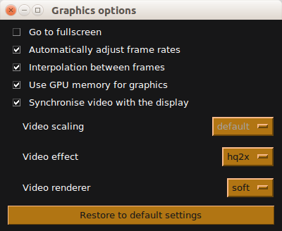
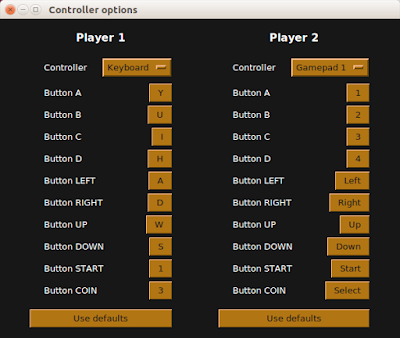
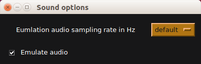
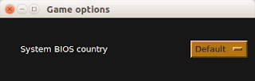

Shopne Arcade - A Frontend for GnGeo NeoGeo emulator written in pure Python

This program uses:

- Python TkInter for the graphical user interface 
- GnGeo for emulating Neo Geo system on Linux PC (rename GnGeo executable to gngeo_bin and copy it alongside with gngeo_data.zip files inside the gngeo subfolder of Shopne Arcade program folder)

To install TKInter on Ubuntu, run the following command into the terminal:

sudo apt-get install python3-tk
    
Shopne Arcade is a front-end application designed to easily play Neo Geo system games on PC. It's interface is compatible for screens with low resolution such as 640x480 pixels. It lets users play Neo Geo system games from one interface where users will be able pick different game play experience settings such as Neo Geo games video resolutions, audio sampling rates, etc. Shopne Arcade is written in pure Python language without any external dependencies making it portable frontend.

Neo Geo system emulation settings and front-end features:

- Playing games in fullscreen mode
- Automatically adjusting video frame rates
- Interpolation between frames
- Using GPU memory for performance
- Synchronising video with monitor refresh rate
- Video scaling
- Video effects
- Selecting of rendering engine (Choose YUV for native like graphics and arbitrary window scaling using window handles)
- Emulating audio in different sampling rates
- Full controller configuration for keyboard and gamepads
- Support for different Neo Geo region BIOS
- Save and Load games states (state files are saved in the directory .gngeo inside users home folder)
- Showing games cover arts (double click into the game list) (cover art png files need to be placed inside the data/covers/ of Shopne Arcade program folder)
- Adding multiple game roms files locations
- Saving all settings

To be able to play Neo Geo games using Shopne Arcade you need a valid Neo Geo BIOS file (neogeo.zip) in same locations where the Neo Geo games rom files are located.

To launch Shopne Arcade, simply execute Shopne.

You can find Shopne Arcade bundled with GnGeo binary packages from the following site:

https://shopnearcade.blogspot.com/
